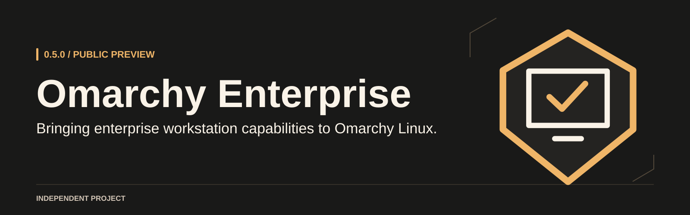
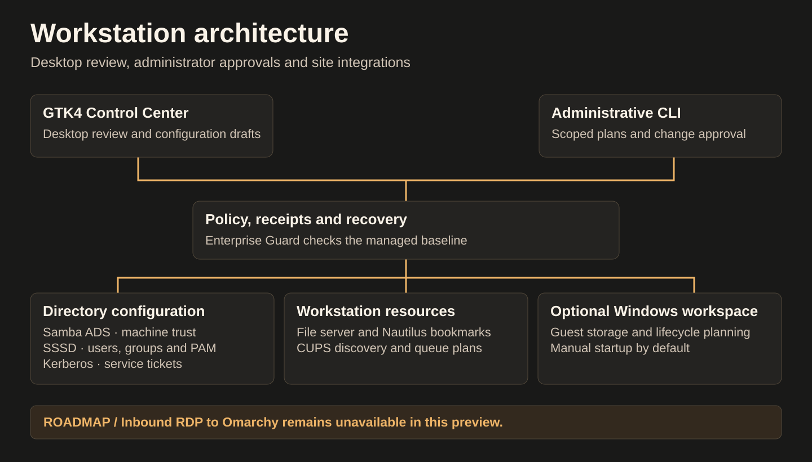

# Omarchy Enterprise



**Bringing enterprise workstation capabilities to Omarchy Linux.**

Created by **[Marco Porro](https://www.marcoporro.it)** ([x.com/MarcoPorro](https://x.com/MarcoPorro) · [www.marcoporro.it](https://www.marcoporro.it))

Repository: **[github.com/piermark/omarchy-enterprise](https://github.com/piermark/omarchy-enterprise)** · Version **0.5.0** (tag `v0.5.0`, package `0.5.0-1`) · License **[MIT](LICENSE)**

[](LICENSE)

Omarchy Enterprise is an unofficial, independent workstation extension designed
specifically for Omarchy Linux. A native GTK4 and Libadwaita Control Center helps
desktop users review configuration, workstation resources and recovery options.
A separate administrative CLI reviews plans and applies scoped changes only with
explicit approval.

> [!WARNING]
> **Early release, not production-ready.** The 163 retained offline regression
> tests pass for this source. Clean Omarchy installation, native desktop launch and
> live integrations (AD, PAM, SDDM, SMB, CUPS, Windows guest) still require
> qualification. Evaluate on disposable systems and keep independent local
> administrator access. See the [availability matrix](docs/availability.md).

> [!NOTE]
> **Release v0.5.0 is source-only for now.** It ships the source archive, the
> illustrated PDF user guide and a signed `SHA256SUMS`. The prebuilt package
> `omarchy-enterprise-0.5.0-1-any.pkg.tar.zst` is built and reproducible, but it will
> be attached to the release only after maintainer signing and clean Omarchy
> acceptance.

---

## Contents

- [Feature overview](#feature-overview)
- [Architecture](#architecture)
- [Command-line tools](#command-line-tools)
- [Release downloads and verification](#release-downloads-and-verification)
- [Install the prebuilt package](#install-the-prebuilt-package)
- [Build the package from source](#build-the-package-from-source)
- [Evaluate from source (no installation)](#evaluate-from-source-no-installation)
- [Feature availability and limitations](#feature-availability-and-limitations)
- [Documentation](#documentation)
- [Roadmap](#roadmap)
- [Security and contributions](#security-and-contributions)
- [License and acknowledgments](#license-and-acknowledgments)

## Feature overview

### Control Center (GTK4 and Libadwaita)

The desktop application for the regular user session, in English and Italian.
It starts on an **Overview** that shows what needs attention, then offers pages for
Active Directory, File Servers, Printers, Windows, Security and Recovery. Pages
review the current state and save drafts; administrative actions stay in a
separate, authorized terminal. A separate **Omarchy Enterprise Installer** entry
stages the Standalone profile and reviews it before any policy deployment. A
Zenity fallback is used when GTK4 or Libadwaita are unavailable.
See [Control Center](docs/control-center.md).

### Standalone profile

Offline profile staging in a private, user-owned directory (mode 0700), with a
journal for recovery and rollback. It installs no packages, starts no services and
does not enroll the machine in a domain. It is the recommended first step.
See [quick start](docs/quick-start.md).

### Active Directory: Samba ADS, SSSD and Kerberos

Generates and reviews Samba ADS, SSSD and Kerberos configuration before any
change approval. Samba maintains the machine trust, SSSD resolves directory users
and groups through NSS and can participate in PAM login, and Kerberos supplies
service tickets. Local diagnostics cover DNS SRV discovery, time synchronization,
machine trust and SSSD resolution. SDDM graphical domain login is an opt-in
integration that stays disabled during evaluation.
See [Active Directory](docs/active-directory.md).

### File servers (SMB) and Nautilus bookmarks

A policy describes friendly names, shares or servers and optional AD groups. After
an administrator deploys it, the desktop user previews eligible Nautilus bookmarks
and confirms the sync. Personal bookmarks are preserved, and each sync keeps a
private checkpoint for recovery. Kerberos access uses the desktop GVFS SMB backend.
See [file servers](docs/file-servers.md).

### Printers (CUPS)

Discovers local CUPS queues and drafts driverless IPP or IPPS queue plans with
names beginning with `oe-` and at most one default. Queue changes check ownership,
endpoints and pending jobs first, and every change has a receipt for recovery.
See [printers](docs/printers.md).

### Enterprise Guard, backup and recovery

Guard compares managed configuration (SSSD, Samba, Kerberos, NSS, PAM and more)
against a saved baseline and reports drift before a new baseline is recorded. An
example Pacman hook is staged for explicit adoption only. Interrupted operations
are recovered from their journals, receipts or bookmark checkpoints with a fresh,
scoped approval. Btrfs snapshots and independent backups are recommended.
See [security](docs/security.md) and [recovery](docs/recovery.md).

### Optional Windows workspace

Plans a digest-pinned Windows guest (edition, capacity and dedicated storage) with
**manual startup and networking off by default**. A loopback FreeRDP client
connects to the guest; Remote Credential Guard is used only when the client exposes
it. Live use needs licensed media and KVM, TUN, filesystem and isolation review.
See [Windows workspace](docs/windows-workspace.md).

## Architecture



Release screenshots of the Control Center are pending capture in an isolated
graphical session (see [assets/screenshots](assets/screenshots/README.md)).

## Command-line tools

| Command | Purpose |
| --- | --- |
| `omarchy-enterprise` | Desktop-user CLI: `desktop`, `install`, `doctor`, `ad-diagnostics`, `file-servers`, `windows-plan`, `windows-connect`, `rdp-capabilities`, `migration`, `recover` and more (`--help` lists all). |
| `omarchy-enterprise-admin` | Administrator CLI for scoped `operational` deploy, rollback, recover and abort with short-lived approval tokens, plus `diagnose`. |

The package also installs 13 workstation commands, originally developed as
reference-host command imports and adapted for packaging:

| Command | Purpose |
| --- | --- |
| `omarchy-enterprise-doctor` | Workstation health checks |
| `omarchy-enterprise-guard` | Guard baseline: `check`, `list`, `backup` |
| `omarchy-enterprise-view` | Terminal management console |
| `omarchy-enterprise-inventory` | Hardware, software and network inventory (`--json`, `--export`) |
| `omarchy-enterprise-compliance` | Compliance report (`--export`) |
| `omarchy-enterprise-audit` | Audit status, rules and queries |
| `omarchy-enterprise-updates` | Update checks, preflight, snapshot and postflight |
| `omarchy-enterprise-printers` | CUPS queue status, discovery and IPP/socket queues |
| `omarchy-enterprise-printer-monitor` | SNMP printer monitoring for a host |
| `omarchy-enterprise-certificates` | List, inspect, install and remove trusted certificates |
| `omarchy-enterprise-provision-user` | Desktop provisioning for directory users |
| `omarchy-enterprise-policy` | Validate, plan and apply workstation policy |
| `omarchy-enterprise-ad-testjoin` | Machine trust check (administrator) |

Administrative commands require an authorized administrator session (for example `sudo`).

## Release downloads and verification

Download from **[Releases](https://github.com/piermark/omarchy-enterprise/releases)**:

| Asset | Description |
| --- | --- |
| `omarchy-enterprise-0.5.0-source.tar.gz` | Source archive with `SOURCE-SHA256SUMS` |
| `Omarchy-Enterprise-User-Guide.pdf` | Illustrated user guide (9 pages, English) |
| `SHA256SUMS` / `SHA256SUMS.asc` | Checksums and their detached OpenPGP signature |
| `omarchy-enterprise-release-key.asc` | Public release signing key |
| `omarchy-enterprise-0.5.0-1-any.pkg.tar.zst` (+ `.sig`) | Prebuilt package, **published after signing and clean Omarchy acceptance** |

Confirm the release key fingerprint through an independent channel (for example
[www.marcoporro.it](https://www.marcoporro.it)) before trusting it:

```sh
gpg --import omarchy-enterprise-release-key.asc
gpg --fingerprint "Omarchy Enterprise Release Signing"   # expect: <FINGERPRINT, published after signing>
gpg --verify SHA256SUMS.asc SHA256SUMS                    # must report a good signature
sha256sum -c --ignore-missing SHA256SUMS                  # every downloaded file must be OK
```

## Install the prebuilt package

> Available once the package asset is published. Requires x86_64 Omarchy 4.5
> (4.5 or 4.5.0). Keep Pacman signature verification enabled.

1. Download `omarchy-enterprise-0.5.0-1-any.pkg.tar.zst`, its `.sig`, `SHA256SUMS`,
   `SHA256SUMS.asc` and the public key, then verify them as shown above.
2. Trust the release key in Pacman's keyring and install:

   ```sh
   sudo pacman-key --add omarchy-enterprise-release-key.asc
   sudo pacman-key --lsign-key <FINGERPRINT>
   sudo pacman -U omarchy-enterprise-0.5.0-1-any.pkg.tar.zst
   ```

   Pacman checks the adjacent `.sig` and resolves `bash` and `python`. For the
   Control Center also install `python-gobject`, `gtk4` and `libadwaita`; other
   optional dependencies (samba, sssd, krb5, cups, gvfs-smb, freerdp, …) are listed by
   `pacman -Qi omarchy-enterprise`.

   Alternatively, the project's bootstrap reviews compatibility, the digest and the
   signer before handing off to Pacman:
   `./install.sh --bootstrap --package ARCHIVE --keyring ./release-keyring.gpg --fingerprint <FINGERPRINT>`.
3. **First launch:** as the regular desktop user, open **Omarchy Enterprise** from the
   menu (or run `omarchy-enterprise desktop`), start with Overview, then open
   **Omarchy Enterprise Installer** (`omarchy-enterprise provision-wizard`) to stage and
   review the Standalone profile. Check `omarchy-enterprise --version` reports `v0.5.0`.
4. **Uninstall:** `sudo pacman -Rns omarchy-enterprise`. Review and roll back any
   deployed policy with `omarchy-enterprise-admin operational rollback` first.
   Upgrades from earlier laboratory builds (for example `0.5.0lab15-2`) are newer
   by `vercmp`.

## Build the package from source

On Omarchy (Arch Linux based) with `base-devel` and `gettext` installed, as a
regular user:

```sh
tar -xzf omarchy-enterprise-0.5.0-source.tar.gz
cd omarchy-enterprise
sha256sum -c SOURCE-SHA256SUMS
cd packaging && makepkg --syncdeps      # runs the 163 tests in check()
sudo pacman -U omarchy-enterprise-0.5.0-1-any.pkg.tar.zst
```

For a byte-reproducible build matching the release, use
`SOURCE_DATE_EPOCH=1795737600 tools/build-beta-package.sh ARCHIVE OUTPUT_DIRECTORY`.

## Evaluate from source (no installation)

```sh
sha256sum -c SOURCE-SHA256SUMS
stage=$(mktemp -d)
./install.sh --root "$stage" --profile standalone --dry-run
```

Source evaluation requires Bash and Python; the full offline suite also requires
Gettext's `msgfmt` (`python -B -m unittest discover -s tests -v`). Replace
`--dry-run` with `--yes` to stage, and review removal with
`./uninstall.sh --root "$stage"`.

## Feature availability and limitations

| Capability | 0.5.0 scope |
| --- | --- |
| Standalone | Offline profile staging, review and recovery |
| Control Center | Native GTK4 interface with English and Italian translations and offline UI model checks |
| Active Directory | Samba ADS, SSSD and Kerberos configuration review and diagnostics |
| Graphical domain login | SDDM review and opt-in integration. Live PAM and SDDM acceptance pending |
| File servers | Managed Nautilus bookmarks and offline recovery. Live SMB authentication pending |
| Printers | CUPS discovery and IPP/IPPS queue plans. Live queue changes pending |
| Enterprise Guard | Baseline checks and scoped recovery with prior reference-host Guard and hook evidence |
| Windows workspace | Optional guest planning with manual startup by default. Live isolation pending |
| Inbound RDP to Omarchy | Roadmap |

See the [availability matrix](docs/availability.md) for evidence and
qualification by workflow.

## Documentation

| Start here | Integration and operations |
| --- | --- |
| [Quick start](docs/quick-start.md) | [Active Directory](docs/active-directory.md) |
| [Installation and verification](docs/installation.md) | [File servers](docs/file-servers.md) |
| [Control Center](docs/control-center.md) | [Printers](docs/printers.md) |
| [Administration](docs/administration.md) | [Windows workspace](docs/windows-workspace.md) |
| [Troubleshooting](docs/troubleshooting.md) | [Security](docs/security.md) and [recovery](docs/recovery.md) |
| [Avvio rapido](docs/it/quick-start.md) | [Installazione](docs/it/installation.md) |

See the [changelog](CHANGELOG.md) for release scope.

## Roadmap

Inbound RDP to Omarchy (independent Hyprland sessions, Windows `mstsc`
compatibility, AD authentication, GPO authorization, NLA and Kerberos, client
drive redirection), signed package distribution, and optional OCS Inventory and
Zabbix integrations. See the [roadmap](ROADMAP.md).

## Security and contributions

Evaluate on disposable systems with synthetic settings and retain independently
recoverable local access. Review approval plans and rollback scope before
changing policy. Keep graphical domain login disabled during source evaluation.
Use the [security policy](SECURITY.md) for private vulnerability reports and
the [contribution guide](CONTRIBUTING.md) for documentation fixes and synthetic
test cases.

## License and acknowledgments

Omarchy Enterprise is licensed under the [MIT License](LICENSE).
Copyright (c) 2026 Marco Porro ([www.marcoporro.it](https://www.marcoporro.it)).
See the [third-party notices](THIRD_PARTY_NOTICES.md) for separately supplied
components, which keep their own licenses.

Development and release preparation used AI assistance from ChatGPT and Codex.

Omarchy Enterprise is an unofficial, independent project. It is not affiliated
with or endorsed by Omarchy.
